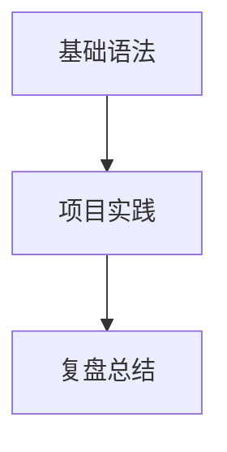

# Gin Blog

Gin 的个人技术博客。文章内容来自 `docs/` 目录下的 MDX 文件，可以按 `frontend`、`python`、`java`、`agent`、`database`、`other` 等主题继续细分。

## 技术栈

- Next.js App Router、React、TypeScript
- Tailwind CSS、shadcn/ui、Motion
- next-mdx-remote、remark-gfm、remark-math、rehype-katex
- Mermaid、Shiki
- pnpm

## 核心能力

- 全文搜索：顶部搜索按钮或 `Ctrl + K`，可搜索标题、正文、标签和文章摘要。
- 代码片段：`/snippets` 读取 `docs/code/`。
- MDX 增强：支持表格、LaTeX、Mermaid、Callout、Tabs、文件树、步骤块和折叠内容。
- 静态部署：支持 Vercel 与 CloudBase，推送 `main` 后自动触发部署流程。

## 本地运行

需要 Node.js 22 和 pnpm 11。

```bash
pnpm install
pnpm dev
```
## 添加文章

在 `docs/` 或任意子目录中新建 `.mdx` 文件，并填写 frontmatter：

```mdx
---
title: '文章标题'
description: '文章描述'
category: '前端'
tags: 'React,Next.js'
date: '2026-08-11'
readTime: '8 分钟'
author: 'Gin'
---
```

文件名会生成文章 slug。首页分类、文章详情、目录和相邻文章会自动生成。

草稿或暂时不希望公开的笔记，可以在 frontmatter 中添加：

```mdx
IS_SHOW: FALSE
```

也兼容在正文第一行使用 `IS_SHOW = FALSE`。隐藏后的笔记不会出现在列表、搜索、统计、项目关联和文章路由中。删除该配置或将值改为 `TRUE` 即可重新展示。

## 添加代码片段

在 `docs/code/` 下新建 `.mdx` 文件：

````mdx
---
title: 'FastAPI JWT 生成'
description: '登录成功后生成 access token 的基础写法。'
language: 'python'
tags: 'FastAPI,JWT,Auth'
date: '2026-08-11'
---

```python title="jwt.py" showLineNumbers
from datetime import datetime, timedelta
from jose import jwt

def create_access_token(data: dict):
    payload = data.copy()
    payload["exp"] = datetime.utcnow() + timedelta(minutes=30)
    return jwt.encode(payload, "secret", algorithm="HS256")
```
````

## MDX 组件与语法

文章可以直接使用下面的组件，无需在 MDX 中导入。组件列表由 `src/components/mdx/mdx-blocks.tsx` 维护。

文章页支持 `tree={[...]}` 等 JavaScript 表达式，仅适用于可信的 MDX 内容。项目页和速查页目前没有启用表达式，因此下面的文件树数组示例适用于文章页。

### 渲染流程与组件注册

`src/app/blog/[slug]/page.tsx` 从 `getPost` 读取文章正文，通过 `next-mdx-remote/rsc` 的 `MDXRemote` 编译并渲染 MDX。`src/lib/mdx-options.ts` 配置解析插件，`getMdxComponents` 将 Markdown 元素和 JSX 标签映射到 React 组件。

| 模块 | 作用 |
| --- | --- |
| `remark-gfm` | 表格、任务列表、删除线等 GFM 语法 |
| `remark-math`、`rehype-katex`、KaTeX CSS | 解析并显示数学公式 |
| `remarkMermaid`、`MermaidDiagram`、`mermaid` | 将 Mermaid 代码块转换为可交互图形 |
| `rehype-pretty-code`、`shiki`、`CodeFigure` | 代码高亮、行号、标题与复制按钮 |

`getMdxComponents(headingCounts)` 返回的全部映射如下；每篇文章使用独立的 `Map` 记录标题 ID，避免同名标题冲突。

| 返回项 | 功能与作用 |
| --- | --- |
| `figure` → `CodeFigure` | 为高亮代码块添加标题、语言和复制按钮；普通 figure 保留原内容 |
| `table` → `MdxTable` | 给表格增加横向滚动容器 |
| `h1`、`h2`、`h3`、`h4`、`h5`、`h6` | 从标题文本生成去重 ID，供文章目录和锚点链接使用 |
| `Callout` | 基于 shadcn Alert 的说明、提示、注意、警告和面试重点块 |
| `Tabs` | 标签页容器，用 `defaultValue` 指定初始页 |
| `TabsList` | 标签按钮组 |
| `TabsTrigger` | 根据 `value` 切换对应内容 |
| `TabsContent` | 显示匹配 `value` 的标签页内容 |
| `MermaidDiagram` | 渲染 Mermaid 源码，提供缩放、平移和复位 |
| `FileTree` | 将路径数组显示为文件目录树 |
| `Steps`、`Step` | 步骤列表容器与带标题的单个步骤 |
| `Details` | 原生可折叠内容，支持默认展开 |
| `Card` | shadcn 卡片容器 |
| `CardHeader` | 卡片头部，组织标题、简介与操作区 |
| `CardTitle` | 卡片标题文本 |
| `CardDescription` | 卡片简介文本 |
| `CardAction` | 头部右侧的操作区 |
| `CardContent` | 正文区域 |
| `CardFooter` | 底部信息或操作区域 |

### 表格

```mdx
| 技术 | 用途 |
| --- | --- |
| Next.js | 页面与路由 |
| MDX | 内容渲染 |
```

### LaTeX

行内公式使用 `$E = mc^2$`，块级公式使用：

```mdx
$$
E = mc^2
$$
```

### Mermaid 流程图

````mdx

````

页面中的 Mermaid 图表支持滚轮缩放、按钮缩放、拖拽平移和复位。

### Callout 提示块

```mdx
<Callout type="interview" title="面试重点">
闭包常考作用域链、变量生命周期和内存泄漏。
</Callout>
```

`type` 支持 `note`、`tip`、`warning`、`danger`、`interview`。

### 代码块

````mdx
```ts title="useCounter.ts" showLineNumbers {2}
const count = 0
const next = count + 1
```
````

支持文件名、复制按钮、行号、指定行高亮和 Shiki 语法高亮。

### Tabs

```mdx
<Tabs defaultValue="react">
  <TabsList>
    <TabsTrigger value="react">React</TabsTrigger>
    <TabsTrigger value="vue">Vue</TabsTrigger>
  </TabsList>
  <TabsContent value="react">React 示例内容</TabsContent>
  <TabsContent value="vue">Vue 示例内容</TabsContent>
</Tabs>
```

### 文件树

```mdx
<FileTree
  rootLabel="my_blog"
  tree={[
    "src/app/page.tsx",
    "src/components/post-explorer.tsx",
    "docs/frontend/javascript-core.mdx"
  ]}
/>
```

`tree` 也可以写成 `items`；路径以 `/` 结尾时表示目录。

### 步骤块

```mdx
<Steps>
  <Step title="安装依赖">运行 `pnpm install`。</Step>
  <Step title="启动项目">运行 `pnpm dev`。</Step>
</Steps>
```

### 折叠内容

```mdx
<Details title="展开查看答案">
这里可以放解析、代码或补充资料。
</Details>
```

添加 `open` 可以默认展开：`<Details title="答案" open>内容</Details>`。

### 卡片

使用官方 shadcn Card 的组合接口，各部分按需添加：

```mdx
<Card>
  <CardHeader>
    <CardTitle>学习笔记</CardTitle>
    <CardDescription>这里是卡片简介。</CardDescription>
    <CardAction><a href="#补充资料">资料</a></CardAction>
  </CardHeader>
  <CardContent>
    这里是卡片正文。
  </CardContent>
  <CardFooter>更新于 2026-11-04</CardFooter>
</Card>
```

各部分支持标准 HTML 属性和 `className`。在 React 文件中先导入需要的组件：

```tsx
import { Card, CardAction, CardContent, CardDescription, CardFooter, CardHeader, CardTitle } from "@/components/ui/card";
```

### Mermaid 组件

除了上面的 Mermaid 代码块，也可以直接使用 `MermaidDiagram`：

```mdx
<MermaidDiagram title="处理流程" chart="graph TD; A[开始] --> B[完成]" />
```

## 检查

```bash
pnpm lint
pnpm build
pnpm build:static
```

## 部署

海外生产地址：[https://xygin.vercel.app](https://xygin.vercel.app)

国内访问地址：[https://gin-blog-gin-d0ghqbprg7d3819db.webapps.tcloudbase.com](https://gin-blog-gin-d0ghqbprg7d3819db.webapps.tcloudbase.com)

项目支持静态导出：

```bash
pnpm build:static
```

构建产物位于 `out/` 目录。推送到 `main` 分支后，Vercel 和 CloudBase 会按已配置的 CI/CD 流程自动部署。
