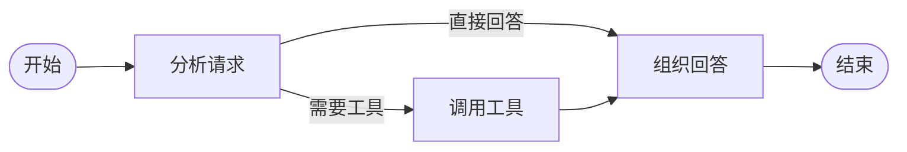

做普通聊天功能时，一次请求通常只有一条直线：接收消息、调用模型、返回答案。开始做 Aura 之后，流程里逐渐出现了更多判断：这句话是否需要调用工具？是否应该读取长期记忆？工具执行失败后要继续回答，还是先重试？

当这些判断全部塞进一个函数，代码很快就会变成层层嵌套的 `if`。LangGraph 提供了另一种思路：把 Agent 看成一个围绕共享状态运行的工作流。

## 从一次对话开始

先把一次 Agent 对话拆成三个阶段：

<Steps>
  <Step title="分析请求">读取用户消息，判断是否需要外部工具。</Step>
  <Step title="执行动作">需要工具时获取信息；不需要时跳过这一步。</Step>
  <Step title="组织回答">结合消息和工具结果，生成最终回复。</Step>
</Steps>

它对应的流程并不是固定直线，而是包含一次条件分支：



这里的关键变化是：我们不再追踪“代码执行到了哪一行”，而是关心“当前处于哪个节点，状态中已经有什么”。

## 状态是工作流的共同语言

示例使用 Python 3.10+、LangGraph 1.x 与 `langchain-core` 1.x，不需要模型密钥。先运行 `uv add "langgraph>=1,<2" "langchain-core>=1,<2"`，把下面四个文件放在同一目录，再运行 `uv run python main.py`。

状态负责在节点之间传递数据。最小示例只保留三个字段：

```python title="state.py" showLineNumbers
class AgentState(TypedDict):
    messages: Annotated[list[AnyMessage], add_messages] # 按消息 ID 合并新增与更新
    needs_tool: bool
    tool_result: str
```

`messages` 使用 `add_messages` 作为 reducer。没有相同 ID 的新消息会追加；相同 ID 的消息会更新已有条目，而不是简单覆盖整个列表。

`needs_tool` 是本轮路由需要的临时判断，`tool_result` 则保存工具节点产生的结果。

<Callout type="tip" title="状态设计原则">
只把后续节点确实需要的数据放进状态。数据库连接、客户端实例等运行依赖更适合通过依赖注入或运行配置传递，而不是塞进可持久化状态。
</Callout>

## 节点只完成一件事

每个节点接收当前状态，并返回需要更新的部分：

```python title="nodes.py" showLineNumbers
def analyze_request(state: AgentState):
    # 节点只返回本次变更的字段，由图合并回状态
    question = str(state["messages"][-1].content)
    keywords = ("天气", "搜索", "查询")
    return {
        "needs_tool": any(word in question for word in keywords),
        "tool_result": "",  # 每轮重新判断，避免复用上一次查询结果
    }

def call_tool(state: AgentState):
    question = state["messages"][-1].content
    return {"tool_result": f"模拟查询结果：{question}"}

def reply(state: AgentState):
    if state.get("tool_result"):
        content = f"我参考了工具结果：{state['tool_result']}"
    else:
        content = "这个问题不需要调用工具，我可以直接回答。"

    return {"messages": [AIMessage(content=content)]}
```

## 用条件边决定下一步

路由函数不处理业务，只根据状态返回下一节点的名字：

```python title="graph.py" showLineNumbers
def route_after_analysis(
    state: AgentState,
) -> Literal["tool", "reply"]:
    return "tool" if state["needs_tool"] else "reply"

builder = StateGraph(AgentState)
builder.add_node("analyze", analyze_request)
builder.add_node("tool", call_tool)
builder.add_node("reply", reply)

builder.add_edge(START, "analyze")
builder.add_conditional_edges( # 路由结果映射到工具或回复节点
    "analyze",
    route_after_analysis,
    {"tool": "tool", "reply": "reply"},
)
builder.add_edge("tool", "reply")
builder.add_edge("reply", END)

agent = builder.compile()
```

运行时只需要提供初始状态：

```python title="main.py" showLineNumbers
result = agent.invoke({ # 初始化每个状态字段，交给图依次执行节点
    "messages": [HumanMessage(content="帮我查询上海天气")],
    "needs_tool": False,
    "tool_result": "",
})

print(result["messages"][-1].content)
```

如果把问题换成“解释一下什么是状态机”，路由会直接进入 `reply`；包含“查询”时，则会先经过 `tool`。同一张图能够描述两条执行路径。

## 回到 Aura，我学到了什么

### 1. 工作流比提示词更容易定位问题

提示词只能告诉模型应该做什么，状态图还能说明程序实际走了哪条路径。回答异常时，可以先确认是路由判断错误、工具结果错误，还是最终回复节点没有正确使用上下文。

### 2. 节点边界决定后续扩展成本

如果“读取记忆、调用工具、生成回复”全在一个节点里，后续很难单独重试或观测。拆成明确节点后，可以分别记录耗时、错误和输入输出，也更容易为某一步增加降级策略。

### 3. 状态需要克制

最开始很容易把所有中间变量都放进状态。这样虽然方便，却会让持久化数据变大，也让节点之间产生隐式依赖。状态应该描述工作流需要共享的事实，而不是充当全局变量容器。
